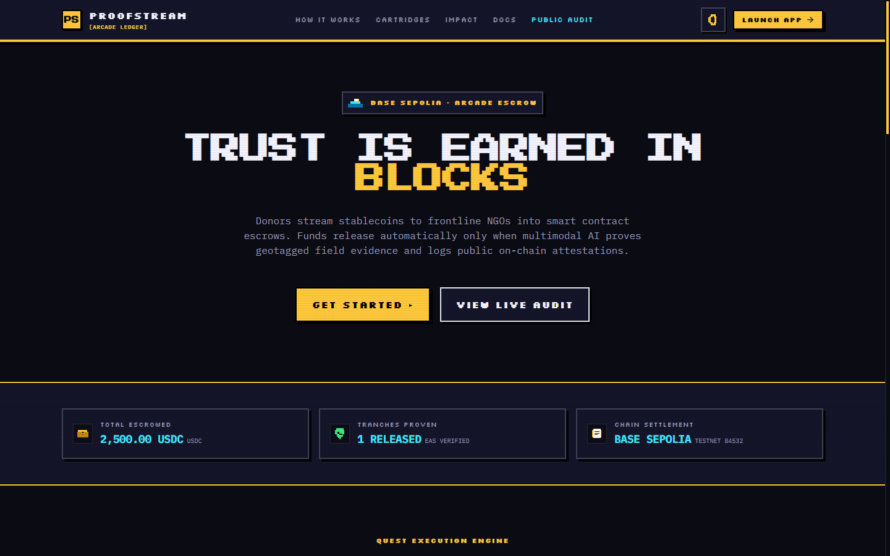
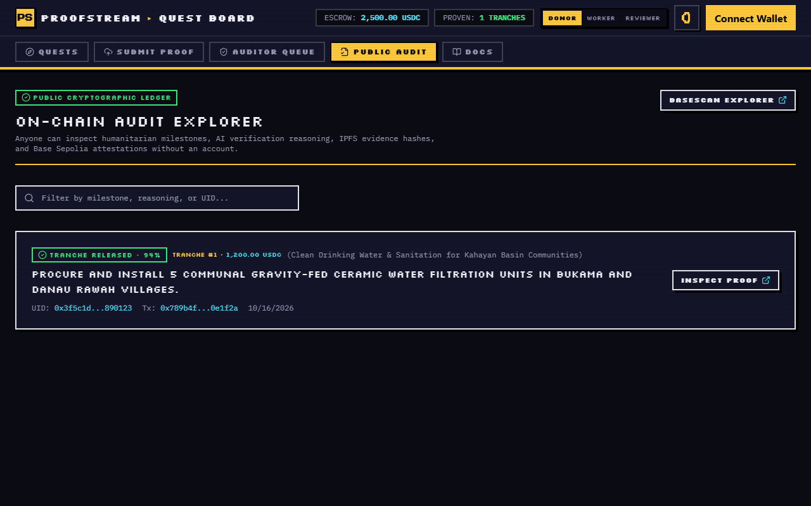
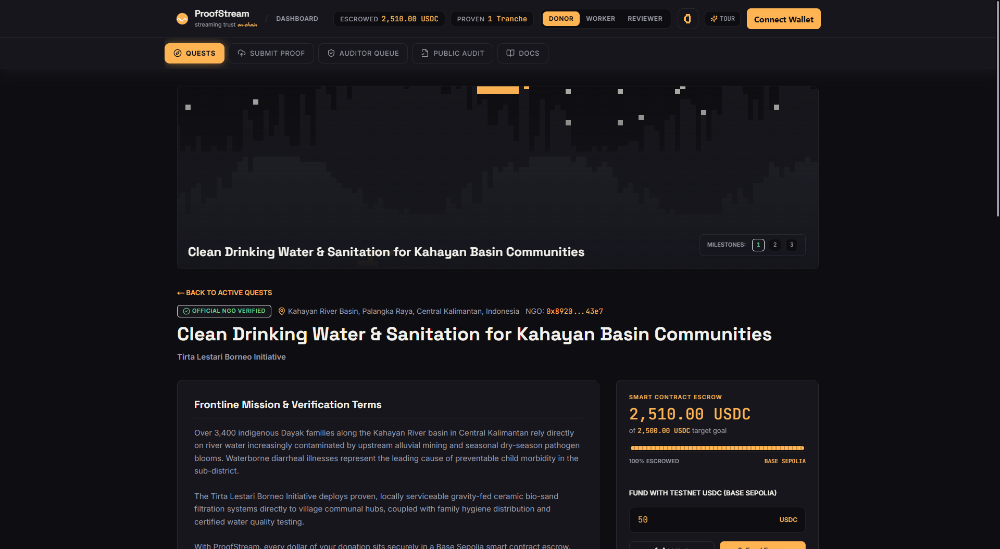
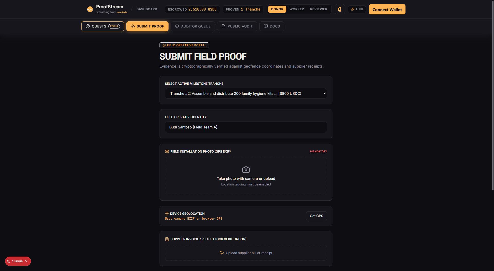

# ProofStream — Autonomous Impact-Gated Streaming Aid Protocol

<p align="center">
  
</p>

<p align="center">
  <a href="https://proofstream-ashen.vercel.app/"></a>
  <a href="https://youtu.be/PWt_gj1h2lo"></a>
  <a href="https://sepolia.basescan.org/address/0xa0eb087d35d33d2306bc182beaa4222c6dd7d3e7"></a>
  <a href="https://github.com/shinothelegend/Proof-Stream"></a>
</p>

---

## 🔗 Quick Links

| Resource | Link |
|---|---|
| 🌐 **Live Web Application** | [https://proofstream-ashen.vercel.app/](https://proofstream-ashen.vercel.app/) |
| 📹 **Walkthrough Video** | [https://youtu.be/PWt_gj1h2lo](https://youtu.be/PWt_gj1h2lo) |
| 💻 **Source Code Repository** | [https://github.com/shinothelegend/Proof-Stream](https://github.com/shinothelegend/Proof-Stream) |
| ⛓️ **Escrow Smart Contract** | [`0xa0eb087d35d33d2306bc182beaa4222c6dd7d3e7` (BaseScan)](https://sepolia.basescan.org/address/0xa0eb087d35d33d2306bc182beaa4222c6dd7d3e7) |
| 📜 **EAS Schema Registry** | [`0xd3de6adb8faf789116a05f59a390b23af5b491a252a0bda2d11c0e8c194062b3`](https://base-sepolia.easscan.org/schema/view/0xd3de6adb8faf789116a05f59a390b23af5b491a252a0bda2d11c0e8c194062b3) |

---

## 💡 What is ProofStream?

Traditional humanitarian aid suffers from an existential trust gap: **only 4.5% of international donations reach local NGOs**, and over **$3.7B is lost annually to procurement fraud and opaque lump-sum wire transfers**.

**ProofStream** replaces blind lump-sum aid with **autonomous impact-gated streaming escrows**:
1. Donors deposit official testnet USDC into a **Base Sepolia smart contract escrow** (`CampaignEscrow.sol`).
2. Funds remain **locked on-chain** in milestone tranches.
3. Frontline NGO teams complete work and upload **geotagged field photos + supplier receipts**.
4. An autonomous **multimodal AI verification agent** (Google Gemini) inspects EXIF GPS coordinates, parses receipt itemizations via OCR, and runs 64-bit gradient dHash checks for duplicate image reuse.
5. Once verified, the escrow **instantly releases that tranche's funds** to the frontline NGO wallet and emits a permanent **Ethereum Attestation Service (EAS)** record on Base Sepolia.

---

## 🔄 How It Works (The Lifecycle)

```
[ Donors ] ────> Deposit USDC ────> [ CampaignEscrow.sol ] (Locked in Tranches)
                                             │
[ Frontline NGO ] ──> Submits Photo + Receipt │ (GPS EXIF + Vendor Invoices)
                                             ▼
                             [ Multimodal AI Agent ]
                             ├─ EXIF Geofence validation (<5 km)
                             ├─ Gemini Vision scene audit
                             ├─ OCR itemized invoice sum check
                             └─ 64-bit perceptual dHash (reuse detection)
                                             │
                       ┌─────────────────────┴─────────────────────┐
                       ▼ PASSED                                    ▼ REJECTED
              [ Tranche Released ]                         [ Funds Retained ]
          Funds streamed to NGO wallet                  Detailed audit flags logged;
        + Base Sepolia EAS Attestation emitted         Human review escalation enabled
```

---

## 📸 Product Walkthrough

| Live Escrow & Campaign Overview | Public On-Chain Audit Explorer |
|:---:|:---:|
|  |  |
| *Real-time on-chain stats ($6,100 USDC escrowed)* | *Immutable BaseScan & EAS attestations per tranche* |

| Milestone Pipeline & Tranches | Field Evidence Submission & AI Review |
|:---:|:---:|
|  |  |
| *Funded milestones locked pending verified evidence* | *Mobile camera QR bridge & real-time verification* |

---

## 🎯 Key Practical Features

- **🎮 Spotlight Interactive Tour**: 1-click guided walkthrough (`driver.js`) anchored to live DOM elements so judges and reviewers can explore the entire flow in under 60 seconds.
- **📱 Mobile QR Evidence Capture Bridge**: Real-time QR code generator allowing field workers to snap high-resolution on-site photos directly on mobile devices with live 5-second polling synchronization to the desktop review dashboard.
- **🛡️ Adversarial Fraud Rejection Demo**: Includes pre-staged adversarial duplicate assets (`public/demo/fraud-attempt.jpg`) to demonstrate live dHash Hamming distance rejection ($< 8$ bit distance) during pitch demos.
- **⚡ Dual-Mode Database Architecture**: Seamless local development with SQLite/Postgres and cloud serverless production powered by **Neon PostgreSQL**.
- **🎨 "Ember & Paper" Design System**: Ultra-clean neutral palette (Space Grotesk headers, Inter body, JetBrains Mono hashes, warm amber accents) with tactile magnetic snap cursor and 8px signature chamfered cards.

---

## ⛓️ On-Chain Smart Contracts & Addresses

| Contract / Asset | Network | Address / Identifier | Explorer Link |
|---|---|---|---|
| **CampaignEscrow** | Base Sepolia | `0xa0eb087d35d33d2306bc182beaa4222c6dd7d3e7` | [BaseScan](https://sepolia.basescan.org/address/0xa0eb087d35d33d2306bc182beaa4222c6dd7d3e7) |
| **Circle USDC (Testnet)** | Base Sepolia | `0x036CbD53842c5426634e7929541eC2318f3dCF7e` | [BaseScan](https://sepolia.basescan.org/token/0x036CbD53842c5426634e7929541eC2318f3dCF7e) |
| **EAS Predeploy** | Base Sepolia | `0x4200000000000000000000000000000000000021` | [BaseScan](https://sepolia.basescan.org/address/0x4200000000000000000000000000000000000021) |
| **EAS Schema Registry** | Base Sepolia | `0x4200000000000000000000000000000000000020` | [BaseScan](https://sepolia.basescan.org/address/0x4200000000000000000000000000000000000020) |
| **Attestation Schema UID** | Base Sepolia | `0xd3de6adb8faf789116a05f59a390b23af5b491a252a0bda2d11c0e8c194062b3` | [EAS Scan](https://base-sepolia.easscan.org/schema/view/0xd3de6adb8faf789116a05f59a390b23af5b491a252a0bda2d11c0e8c194062b3) |

---

## 💻 Local Developer Quickstart

### 1. Prerequisites
- **Node.js** v20+ 
- **Foundry** (`forge`) for Solidity contract tests

### 2. Clone & Install Dependencies
```bash
git clone https://github.com/shinothelegend/Proof-Stream.git
cd Proof-Stream
npm install --legacy-peer-deps
```

### 3. Environment Configuration
Copy the template and provide your keys:
```bash
cp .env.example .env
```
Key environment variables:
- `DATABASE_URL`: Connection string (Neon PostgreSQL or `file:./dev.db`)
- `GEMINI_API_KEY`: Google GenAI API Key for multimodal verification
- `VERIFIER_PRIVATE_KEY`: Server-side key authorized to call `releaseMilestoneWithAttestation`

### 4. Database Setup & Demo Seed
```bash
npx prisma generate
npx prisma db push
npx tsx prisma/seed.ts
```
*Seeds 2 realistic NGO campaigns (Kalimantan Clean Water $2,500 USDC & Turkana Solar Cold-Chain $3,600 USDC).*

### 5. Smart Contract Tests
Execute the comprehensive Foundry test suite:
```bash
forge test -vvv
```
*(5/5 tests passing with zero failures)*

### 6. Start Development Server
```bash
npm run dev
```
Open **[http://localhost:3000](http://localhost:3000)** in your browser.

---

## 🏗️ Technical Architecture

- **Frontend & Serverless API**: Next.js 15 (App Router), React 19, Tailwind CSS, RainbowKit, Wagmi, Viem
- **Smart Contracts**: Solidity 0.8.24, OpenZeppelin v5 (ReentrancyGuard, SafeERC20, Ownable), Foundry
- **AI Verification Engine**: Google Gemini Multimodal SDK (`@google/genai`), Exifr, Canvas OCR, Gradient dHash
- **Database & Storage**: Prisma ORM, Neon PostgreSQL, IPFS (Pinata gateway)
- **Attestations & Trust**: Ethereum Attestation Service (EAS) SDK on Base Sepolia

---

## 📜 License

MIT License — free for non-profit and open-source humanitarian aid distribution.
